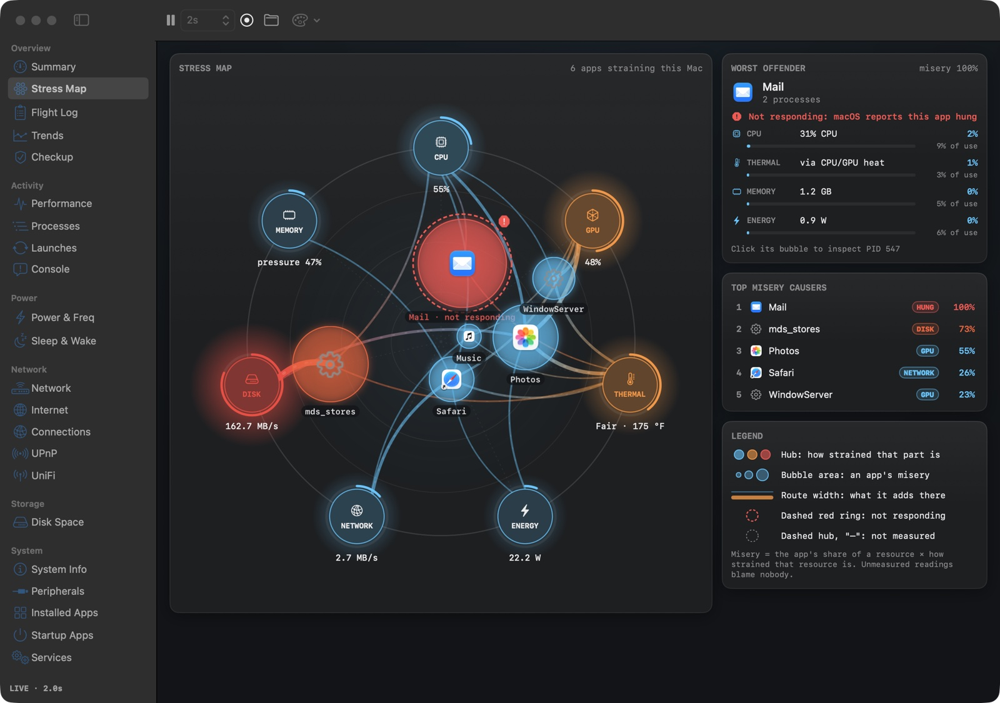
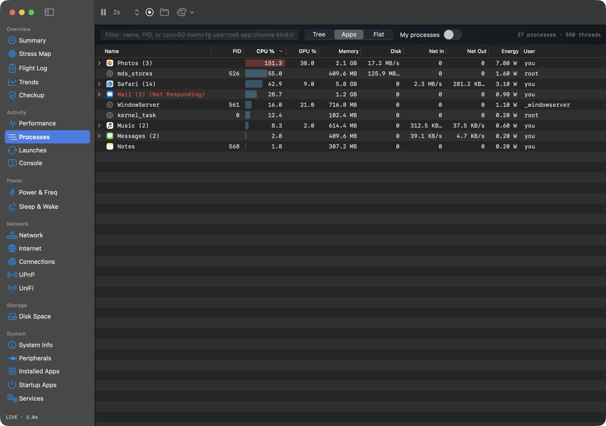
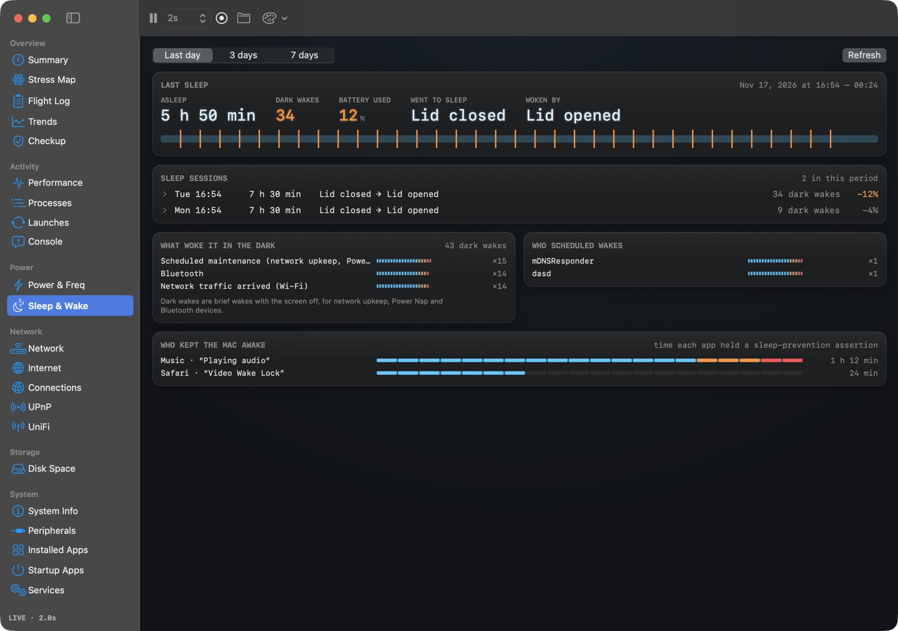
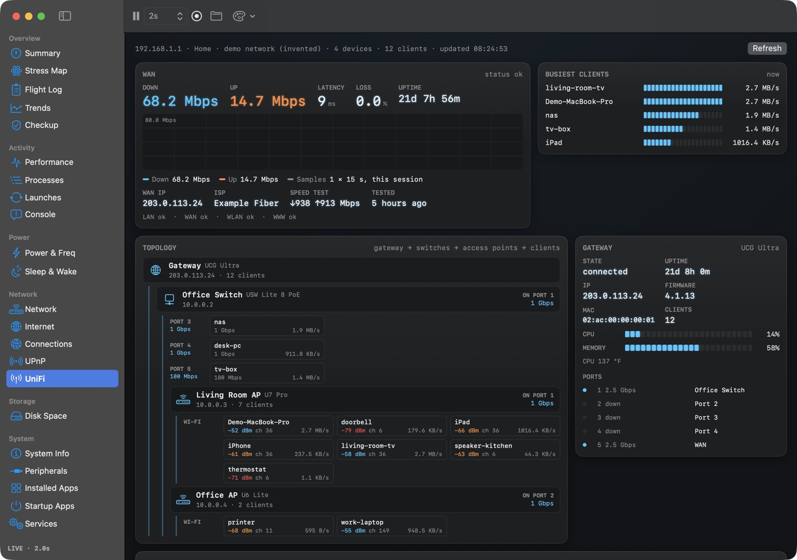
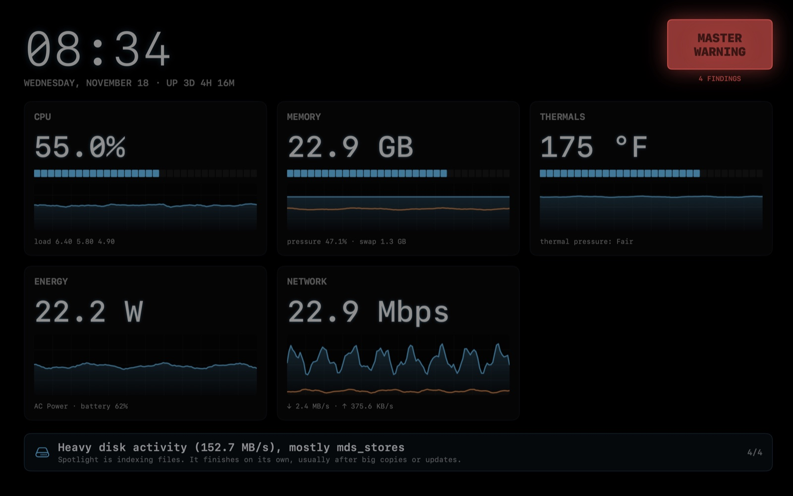

# FlightDeck

A native macOS task manager and system monitor (Swift, SwiftUI + AppKit). It answers "why is my Mac slow?"
by showing which process and which subsystem is responsible.

## Screenshots

These are taken in demo mode, which feeds the real UI invented data (a busy "Demo Mac" on an invented network), so nothing here describes a real machine.

| | |
|---|---|
|  **Summary:** a customisable cockpit of instruments, the annunciator panel and what's wrong right now |  **Stress Map:** which apps are straining which parts of the Mac, animated between samples |
|  **Flight Log:** a 24 h timeline, past incidents with stack evidence, and macOS crash/hang reports |  **Trends:** 90 days of daily history, with before/after comparisons around updates |
|  **Processes:** grouped by app, with GPU, disk, network and energy per process |  **Performance › CPU:** per-cluster load and clocks, coloured by performance/efficiency core |
|  **Performance › Energy:** what the charger negotiated and where the power goes |  **Sleep & Wake:** dark wakes, overnight drain, and who kept the Mac awake |
|  **Network:** the devices on the local network, from this Mac to the internet |  **Internet:** speed and responsiveness tests explained, and data usage per app |
|  **UPnP:** UPnP devices and the port mappings apps opened on the router |  **UniFi:** a UniFi console's real topology: which AP or switch port each client is on |
|  **Disk Space:** what is using the disk, "System Data" explained, and safe cleanups |  **Developer:** dev servers, containers, Homebrew services, builds and toolchains |
|  **Rules:** automatic responses to sustained problems |  **Cockpit editing:** add, remove, reorder and resize instruments; save layouts |
|  **Ambient mode:** a dim full-screen instrument panel for a second display |  |

## Build & run

```sh
./scripts/bundle.sh          # universal (arm64 + x86_64) release → build/FlightDeck.app
open build/FlightDeck.app
swift test                   # core sampler tests
```

Requires macOS 14+, Xcode 16+ toolchain.

**Distributing:** `./scripts/release.sh` builds `build/FlightDeck.dmg` (drag-to-Applications). With
`SIGN_ID="Developer ID Application: … (TEAMID)"` it signs with the hardened runtime (`scripts/FlightDeck.entitlements`);
add `NOTARY_PROFILE=<notarytool keychain profile>` to notarize and staple, so it opens on any Mac without Gatekeeper
warnings. Without them the app is ad-hoc signed, which is fine for your own Mac. Open at login works best from
/Applications.

**Releases:** pushing a version tag (`git tag v1.2.3 && git push origin v1.2.3`) runs `.github/workflows/release.yml`,
which tests, builds the DMG and a zip (version taken from the tag), and publishes them with SHA-256 sums as a GitHub
Release. It signs and notarizes when the Developer ID secrets listed at the top of that workflow are set; otherwise the
build is ad-hoc signed and the release notes explain how to open it past Gatekeeper.

## Pages

The sidebar groups the pages as below (sections fold away; ⌘1–⌘9 jump to the first nine). Every page also has a
demo-data version for screenshots (see Demo mode at the end).

- **Overview:** Summary (the cockpit) · Stress Map · Flight Log · Trends · Checkup
- **Activity:** Performance (CPU, Memory, Disk, Network, Energy, Thermals, GPU) · Processes · Launches · Console
- **Power:** Power & Freq · Sleep & Wake
- **Network:** Network · Internet · Connections · UPnP · UniFi
- **Storage:** Disk Space
- **System:** System Info · Peripherals · Installed Apps · Startup Apps · Services · Users
- **Tools:** Rules · Developer · Benchmarks

### Overview

Is my Mac OK, now and over time?

**Drill down from Summary:** click any instrument (a "›" in its corner, a pointing-hand cursor and a tooltip show where it goes) to open the detailed view behind it: CPU and CPU Cores open Performance › CPU; Memory, Memory Pressure and Swap open Performance › Memory; Disk, Network and Wi-Fi Signal, GPU, Energy and Battery & Charge, and Thermals and Fans open their Performance tabs; Top Processes opens Processes; the mini Stress Map opens the Stress Map. The annunciator lights and each finding already open their own causes.

**Customizable cockpit:** the Summary page is a grid of instruments you can arrange. Click **Edit** (⌥⌘E) to get a
strip above each instrument with a drag handle, a size control (S = one column, M = two, L = the whole row), move
buttons and a remove (×) button, plus an "Add instrument" palette. Drag instruments onto each other to reorder them;
**Done** leaves edit mode. Besides the classic Summary cards (annunciator, findings, CPU, Memory, Disk, Network, Energy,
Thermals, GPU, Top Processes) there are CPU Cores (a per-core strip, or per-core tiles when large), Memory Pressure,
Swap, Fans, Battery & Charge, Wi-Fi Signal, a static mini Stress Map, and Clock & Uptime. Layouts are named and saved
as JSON in user defaults (`cockpitLayouts`); the layout menu switches between them (Default, Thermals, Network,
Ambient, plus your own via Duplicate Layout) and resets one or all of them. Nothing is saved until you edit, and the
Default layout is the classic Summary page, so the page looks the same until you change it.

**Annunciator panel:** across the top of Summary, a cockpit-style grid of labelled lights (CPU, MEM, SWAP, THERM,
DISK, STORAGE, NET, GPU, POWER, HANG, CRASH, AWAKE), each lit amber or red by the worst current finding in that
subsystem. Hover to see why; click to jump to the cause.

**Ambient mode:** View › Ambient Mode (⌃⌘A), or the Ambient menu on Summary, opens a separate full-screen instrument
panel, meant for a second display or an iPad via Sidecar (View › Ambient Mode on Display picks the screen; the last one
used is remembered). It shows a big clock and uptime, the master caution light (lit with a steady glow while an
unmuted caution or warning is active), large gauges for the gauge-type instruments of the Ambient layout (or another
layout chosen under "Gauges From"), and a findings ticker that steps to the next finding every 8 s. It's dim by
default (right-click for brightness), the pointer hides when it rests, and Esc exits. To avoid burn-in the whole
panel moves by one point a minute around a 12-point square. Like the cockpit it redraws only once per sample (plus a
once-a-minute tick for the clock), with no continuous animation.

**Stress Map:** a graphical answer to "what is making my Mac miserable?". Subsystems (CPU, GPU, Thermal, Energy,
Network, Disk, Memory) are hubs around a ring, coloured by how strained each one is; apps are bubbles sized by how much
misery they cause and pulled toward the hubs they strain, with routes whose width shows how much they add there.
Hover for an app's breakdown, click to inspect it. Misery = the app's share of a resource × how strained that resource
is (power draw counts fully only on battery); unmeasured readings blame nobody. Works in replay too. Changes animate:
bubbles glide to each new sample's position, routes and hub gauges ease to their new strength, and traffic flows along
the routes toward the hubs. It's drawn with Core Animation, so the motion runs in macOS's render server and costs about
the same CPU as a static map. Settings › General › "Animate the Stress Map" (or macOS's Reduce Motion) turns it off.

**Diagnosis and Flight Log:** an analyzer turns the sample stream into plain-English findings on the Summary banner
(click one to jump to where to look). It smooths over spikes and groups helper processes into their app. It detects
apps hogging CPU, memory pressure and growing swap, apps whose memory grows steadily (likely leaks), thermal throttling (and explains kernel_task), measured CPU throttling (busy performance cores held well below their top clock while hot), heavy disk or network I/O, frequent wake-ups, a startup disk that will fill up within days,
and anything unusual for *this* Mac, compared with a baseline built from the black box's 24 hours. Well-known
background work (Spotlight, Time Machine, iCloud, Photos analysis, updates) is explained. Anything lasting 20 s or
more goes into the **Flight Log** (kept 7 days) with a one-click replay of that moment from the black box. A **timeline** (1/6/24 h) of CPU, memory pressure and temperature with incident markers sits on top; click any moment to replay it. The Flight Log also lists **macOS reports** from the last 7 days (crashes with exception type, hangs, memory kills, CPU and disk-write limit violations), and an app that crashes or hangs repeatedly becomes a finding. When an app hangs or hogs the CPU or GPU, FlightDeck **captures its call stacks automatically** (3 s with `/usr/bin/sample`, at most one per problem every 10 minutes) and attaches them to the incident with a one-line summary such as "Main thread waiting in __psynch_mutexwait ← -[Model sortItems:]" (Settings to turn off; kept 7 days). Muting (right-click a finding) can target one finding or a whole kind (e.g. every not-responding alert); muted findings don't notify or light the caution lights and are listed as muted in the banner. Right-click a finding to inspect the responsible process, quit its app, or mute its alerts.

**Trends** keeps one compact record per day for 90 days (`~/Library/Application Support/Flightdeck/daily-log.json`),
folded from the samples FlightDeck already takes: average and 95th-percentile CPU, memory pressure, peak swap, energy,
hottest sensor, sleep, crashes, hangs and incidents, macOS version, battery health and cycles, and the top ~30 apps' CPU
time, energy, peak memory and version. Charts cover 7, 30 or 90 days, with markers on days macOS or an app changed
version; pick an update for a **before/after** comparison in plain English ("Since Safari 26.2: energy +44%, 2 hangs
vs 0"). After 5 days it learns what is **normal for this Mac** per app and raises a finding when an app stays far above
it for 10 minutes ("Safari is using 3× its usual memory (usually ~1.8 GB)"). Performance › Energy and Trends show
**where this charge went**: each app's share of the energy since the Mac was unplugged. Days FlightDeck didn't run are
gaps, never zeros.

**Checkup** is a one-page health and security checklist: SIP, FileVault, Gatekeeper, firewall, Startup Security,
automatic and pending updates (the network check runs only when you press Check Now), Time Machine, free space, drive
and battery health, crashes and hangs this week, uptime, swap trend, login and background items, third-party kernel and
system extensions. Each row is OK, needs attention or unknown (with the reason), and links to the setting that fixes it.

### Activity

What is running and what it costs. Performance has tabs for CPU, Memory, Disk, Network, Energy, Thermals and GPU.

**Processes** can be shown as a parent/child **Tree**, grouped by **Apps** (every helper rolled into its app, with
app-level Quit / Force Quit), or **Flat**. The filter understands queries: `cpu>50 mem>1g user:root app:chrome kind:intel gpu>0 wakeups>500 sleep hung` (terms combine; plain text matches name, path, user or PID). Right-click the column header to choose columns; layout persists. ⌘1–⌘9 jump between sections (Go menu). The **Kind** column shows Apple-silicon or Intel (Rosetta) binaries, and **Sleep** shows who is keeping the Mac or display awake (also a finding, with the reason the app gave). Apps the window server considers hung are marked **Not Responding** in red
and raise a warning finding.

**Process inspector:** double-click a process (or ⌘I, or Inspect… in its menu) to open it in its own window:
CPU, memory, disk and network history (every process's last 300 samples are kept, not just the busiest), PID,
parent and children, user, start time, CPU time, energy, wake-ups, arguments, working directory (the environment is shown only where macOS allows it), code signature
(Apple, Developer ID, ad-hoc or invalid; team; hardened runtime), kernel statistics with rates (page faults, page-ins, Unix and Mach syscalls, context switches, Mach messages, resident/virtual and peak memory, instructions per cycle, logical writes), every open file descriptor, sockets with addresses
and TCP state, threads (CPU, state, priority, times), the environment, and call-stack sampling via
`/usr/bin/sample` to see why it's busy or hung. Actions: quit, force quit, suspend, resume, lower priority (nice).
Anything macOS doesn't let a normal user read for other users' processes is shown as unavailable.

**Connection quality** (Performance › Network): Wi-Fi signal, noise, SNR, link rate, channel, band, width, PHY and
security from CoreWLAN, plus router and DNS servers, all local. An opt-in probe (off by default) pings the router and
an internet host every 10 s, so FlightDeck can tell "your Wi-Fi is the problem" from "your internet provider is".

**Energy and storage health:** Performance › Energy has an **energy budget**: which apps used the most energy
(Wh and average W) over the last 1, 8 or 24 hours, how long the Mac ran on battery and how much charge that took,
and a battery charge history, all from the black box. Battery health uses the same capacity figure as macOS
(nominal ÷ design). Performance › Disk shows **drive health** from the SSD's NVMe SMART log (wear, spare,
lifetime reads and writes, power-on hours, unsafe shutdowns, media errors) and how many days until the startup
disk fills at the current rate. Unhealthy drives raise a warning.

**Charging insights** (Performance › Energy): what the charger negotiated, read from AppleSmartBattery via IOKit in
the same read as the battery readings: rated watts, the USB-PD offers and the one in use ("this charger offers
5/9/15/20 V; it's using 20 V × 4.7 A = 94 W", from `UsbHvcMenu`, or decoded from the USB-C port controller's PD
capabilities), the adapter type and the port controller carrying the contract. A **flow diagram** shows adapter → Mac
and adapter → battery (or battery → Mac) in watts each sample, from Voltage × Amperage and PowerTelemetryData. The
current charge session's **charge curve** (charge % and charge power, in memory only) comes with time to 80% and
100%, labelled as macOS's own estimate or the recent rate, an explanation of the constant-voltage slowdown above 80%,
and **hold detection**: plugged in but not charging (Optimized Battery Charging, a charge limit or heat), backed by
`pmset -g batt` wording and the charger's not-charging code when present. Weak chargers are flagged from measurements
only: macOS's slow-charging flag, the battery draining while plugged in, or a charger rated below the most this Mac
has drawn since launch. **Battery facts** add cycles vs design cycles, design vs full-charge capacity, temperature,
cell voltages, condition and the manufacture date where decodable, with a link to the health history in Trends.
Anything a Mac doesn't publish shows as "not reported by this Mac"; desktops get a "no battery" note.

**Why is the fan loud?** (Performance › Thermals): when fans spin above idle or thermal pressure rises, a card connects
fan speed (against its minimum and maximum), the hottest sensor, whether macOS is holding the CPU/GPU back for heat, and
which apps produce the heat, e.g. "Fan at 4,200 rpm (idle ~1,200) because the CPU is at 92 °C; Photos is responsible for
~60% of the power draw." On fanless Macs it explains throttling instead.

**Thermals** adds fan speeds from the SMC (RPM, min, max, target, history) and a sensor heatmap of every
temperature sensor, hottest first.

**GPU** (Performance › GPU): utilisation (device, renderer, tiler), active residency, live average clock and a
per-P-state histogram, GPU power, GPU memory in use against Metal's recommended working set, driver
**recoveries** (GPU hangs that macOS reset), thermal clock capping, per-app GPU share and total GPU time (also a
GPU % column in Processes and a graph in the inspector), live CPU cluster clocks, and Metal and display details.
The data comes from the accelerator's statistics and IOReport, readable without root. Energy channels macOS hides
from normal users (CPU, ANE, DRAM) are shown as unavailable, not 0. Findings cover GPU hangs, thermal capping,
GPU memory near its limit, and apps hogging the GPU.

**Launches** lists process launches and exits seen between samples (name, PID, parent, user, lifetime), with
"launched N× in the last 10 minutes" grouping, and raises a finding when something respawns over and over. Processes that
live less than one sample interval are missed. The inspector also gains a **Memory** tab that breaks a process's memory
into heap, graphics, mapped files, code, stacks and so on (via `footprint`/`vmmap`; your own processes only).

**Console:** errors and faults from the unified log over the last 5 minutes, hour or 24 hours, grouped by process and
subsystem with counts and sparklines, the noisiest processes, sample messages per group, a filter, and a live tail
(`log stream`, only while the window is visible). Keeps the newest 20,000 messages; 24 h queries are read newest-first in
hourly chunks with progress and Cancel, and stop at 1 million messages. macOS redacts message details it considers
private as `<private>`; the Console says how many are affected.

### Power

Power & Freq shows clocks, power states and throttling.

**Sleep & Wake** reads the power-management log (no root): every sleep session with why it slept, what woke it,
each dark wake (screen-off wakes for network upkeep, Power Nap, Bluetooth) in plain English, battery used overnight,
which processes scheduled wakes, and which apps kept the Mac awake and for how long.

### Network

Connections lists this user's sockets, with the listening-ports panel on top.

**Network** is a map of the local network: this Mac, its interface (Wi-Fi with network name, access point BSSID and
channel), the subnet with every device seen on it, the gateway, and the path to the internet. Other interfaces (a VPN
tunnel, a second Ethernet) are separate branches. Click a device for its details: IPv4 and IPv6 addresses, MAC,
manufacturer (from a bundled table of ~13,000 MAC prefixes of common vendors, generated from the IEEE registry by
`scripts/gen-oui.py`), model, reverse-DNS and Bonjour names, advertised services, first and last seen, and a guessed type
(router, phone, computer, printer, TV, speaker, smart home, NAS, camera…) with the reason for the guess. A sortable list
of every device sits below. Sources: the ARP and IPv6 neighbour tables, the routing table, this Mac's interfaces,
CoreWLAN, reverse DNS and a Bonjour browse of ~25 common service types (with `_device-info` models). Randomized
(private) Wi-Fi MAC addresses are shown as "private address", never as a vendor. Nothing runs unless the view is open:
a full survey when it appears or on Refresh, then a re-read of the ARP table every 10 s. Two buttons send packets, and only
when pressed: **Active scan** pings each address of the subnet once (at most a /24, 50 per second) so every device
that's on answers ARP, and **Traceroute** traces the hops to 1.1.1.1. A Mac can't see link-layer topology (which switch
port or access point each device uses), so devices are drawn on their subnet, not wired to the router. macOS asks
for **Local Network** permission the first time; without it, macOS 27 returns an empty ARP table and blocks Bonjour, and
the view says so. The Wi-Fi name and BSSID need Location Services permission. In demo mode the view shows an invented
network.

**Internet** (speed test only on request or on the opt-in schedule): runs macOS's own `networkQuality` (Apple's
test servers) and shows download and upload in Mbps, responsiveness in RPM (round trips per minute under load, with
Low < 200 · Medium < 800 · High as FlightDeck's bands), idle latency and the loaded latency derived from RPM, then
explains the result in plain English: what the speeds are good for, bufferbloat (how much a busy link adds to latency),
and whether Wi-Fi (signal and link rate) or the router (latency probe) looks like the bottleneck, compared with the
link as it was when the test started. A test takes about 15–20 s and transfers real data (hundreds of MB on a fast
line). Settings › Network can schedule one every 1, 3 or 6 hours (off by default); scheduled tests only run while
FlightDeck runs and are skipped on battery below 20%, on hotspots or metered connections (`NWPath.isExpensive`) and in
Low Data Mode. Results are kept for 90 days in `~/Library/Application Support/Flightdeck/speedtests.json`, with 7- and
30-day charts. **Data usage by app**: today, 7 and 30 days per app (in and out, with a 30-day sparkline), the totals,
and a flag when an app's day is far above its own median day. Counted from nettop's per-process byte counters in the
daily log's 10 s per-app pass (no extra sampling; a restarted process starts a new counter), stored per day in the
daily log (`DayRecord.dataUsage`, optional so older logs still load). Only traffic while FlightDeck runs is counted;
days it didn't run are gaps. Demo mode shows invented tests and usage and never runs networkQuality.

**UPnP:** the devices that answer UPnP discovery on the local network (an SSDP M-SEARCH, plus passive NOTIFY
announcements while the page is open; nothing runs in the background), drawn as a map with the router at the centre and
media renderers, media servers, printers and other devices around it. Click a device for its description: name,
manufacturer, model, device type, its web page, services and embedded devices (serial numbers are hidden unless you ask).
If the router is a UPnP Internet Gateway Device, **Router port mappings** lists every port it has forwarded at an app's
request (protocol, external port, the LAN device and port it goes to, the app's description, lease), with its external
IP and mappings to this Mac flagged, so it's clear which apps opened holes through the router. FlightDeck only reads
them; it never adds or removes a mapping. Descriptions are fetched only from the device that answered, with short
timeouts and size caps. macOS may ask for Local Network access the first time.

**UniFi** (Settings › Network › UniFi, off until configured): reads a UniFi network from a UniFi OS console (Dream Machine,
Dream Router, Cloud Gateway, Cloud Key) or a self-hosted UniFi Network application, and shows the real topology (gateway →
switches, with the port each device is on → access points → clients grouped under their AP or switch port, with link
speeds), device health (CPU, memory, temperatures, firmware, uptime, ports with PoE, AP radios with channel, utilization
and clients), clients (signal, channel, Wi-Fi standard, SSID, link speed, traffic and rates, sortable, plus the busiest
right now), and WAN health (WAN IP, ISP, throughput with a graph for the visible session, latency, uptime, the last
speed test). Setup: create an API key in UniFi Network › Settings › Control Plane › Integrations (or use a local
read-only account), enter the console's address, site (usually `default`) and key in Settings › Network › UniFi, press Test
connection, compare the certificate's SHA-256 fingerprint with the console's and trust it. The API key uses the official
Integration API, plus the classic `stat/*` endpoints with the same key where the console accepts it (they carry switch
ports, signal, traffic and WAN health); username/password uses the classic API. Read-only; credentials live only in the
Keychain; the trusted certificate is pinned (a changed one is refused). It polls every 15 s only while the UniFi view is
open. With nothing configured, opening the view checks whether the default gateway is Ubiquiti hardware (ARP) or answers
like UniFi OS (one unauthenticated HTTPS GET) and suggests it; no credentials are sent anywhere you haven't configured.
Anything the console doesn't report is shown as unknown. For other features, `UniFiSnapshot.attachment(ofMAC:)` and
`UniFiTopology` (FlightDeckCore) say which AP or switch port a MAC address is on.

### Storage

**Disk Space › What's Using My Disk** (next to the folder scanner): the startup disk's APFS container as one stacked
bar, from `diskutil apfs list -plist` and `diskutil info -plist /` (no root): your data, purgeable space ("available
for important usage" minus available), the sealed macOS volume, Preboot, Recovery, swap (VM), Update, APFS overhead and
free, each explained. What Storage settings calls "System Data" is mostly the Data volume's caches, snapshots and app
files, and this view says so. Local Time Machine snapshots (`tmutil listlocalsnapshots /`) are listed with dates; their
sizes need root, so they show as unknown. Below that, **known space hogs**: app caches, logs, the Trash, old downloads,
iPhone/iPad backups, Xcode DerivedData, archives, device support and previews, simulator devices and runtimes (`simctl`
from the selected Xcode, never the `xcrun` shim, which can pop up an install dialog), Docker/OrbStack/Colima disk images,
the Homebrew cache (`brew --cache`), npm/Yarn/pnpm/pip/Cargo/Gradle caches, Mail downloads, Messages attachments, the
Photos library (size only), `Install macOS*.app` installers and Parallels/UTM/VMware VMs. Each says where it is, whether
it's safe to remove and what happens if you do. Nothing is measured until you press **Analyze** (with progress and
Cancel), because reading Downloads, Pictures, Mail, Messages, the Trash or other apps' containers makes macOS ask for
access; refused folders show as "not readable", never 0. Sizes are allocated bytes (`totalFileAllocatedSizeKey`).
Cleanups are only the safe ones: move a category's own items to the Trash (with a confirmation listing every item and
the total), Empty Trash via Finder, `simctl delete unavailable`, and `brew cleanup` after showing `brew cleanup -n`.
FlightDeck never deletes anything itself, never needs root and refuses any path outside the category's folders, outside
your home and /Applications, behind a symlink or SIP-protected. Afterwards it re-measures and reports before and after.
Personal data (backups, archives, Messages, Photos, VMs, container images) gets advice, not a button. Demo mode shows an
invented disk and never runs a cleanup. Code: `Sources/FlightDeckCore/StorageBreakdown*.swift`, `SpaceHog*.swift`,
`DirectorySizer.swift`, `CleanupPlanner.swift`; views in `Sources/FlightDeck/Views/StorageModel.swift` and friends.

### System

System Info, Installed Apps, Services (launchd) and Users are inventories of this Mac.

**Startup Apps** shows who signed every launch agent, daemon and login item, flags unsigned ones, and marks items
whose program no longer exists (leftovers from removed apps), with a summary at the top.

After each wake, a restless or draining night (30+ dark wakes, or 10%+ battery lost while asleep) becomes a finding that names the main cause.

**Peripherals**: the USB tree (speed, power drawn), Thunderbolt/USB4, displays (resolution, refresh, HDR), Bluetooth
devices with battery levels, audio devices and the power adapter. **Connections** adds **listening ports**: which
process listens on which port, flagging services open on all interfaces. It uses `netstat` (every process) when macOS
gives the app the socket table, and otherwise falls back to `lsof` (your own processes only) and says so; on macOS 27,
netstat launched from an app returns no Internet sockets even though it works in Terminal.

### Tools

Benchmarks runs short CPU, memory and disk tests.

**Rules** automate responses: "when app *Chrome* has CPU % above 300 for 10 minutes, notify me / lower its priority /
suspend / quit / force quit / run a command". Commands get `FD_RULE`, `FD_SUBJECT`, `FD_PIDS`, `FD_METRIC` and `FD_VALUE`
in their environment (names are never spliced into the shell). Rules fire once per occurrence with a cooldown, signals
are identity-checked, and every action posts a notification and lands in the Flight Log and a saved action log.
Safety rails: quit/suspend/renice never touch macOS components (anything under /System, /usr, /bin, /sbin), Finder, Dock,
terminals, the app you're using, or FlightDeck itself; app rules quit through the app (so it can ask to save);
destructive rules always wait at least a minute, and a match-everything destructive rule must be explicitly confirmed;
suspended apps resume automatically (and when FlightDeck quits); commands time out after 60 s with their output logged.
"Test Against the Last 24 Hours" dry-runs a rule on the black box before you save it.

**Developer:** for people who code on this Mac. **Dev servers** lists your own processes listening on TCP ports that are
recognised developer tools (Vite, Next.js, webpack dev server and other Node/Bun/Deno servers; uvicorn, gunicorn, Flask,
Django runserver, Jupyter; Rails and Puma; Gradle, Spring Boot and other Java; `go run` and Cargo builds; PHP;
Postgres, MySQL, Redis, MongoDB; Ollama and LM Studio; Docker, OrbStack and Lima port forwarders), identified from the
executable and command line. Each row shows the port, a clickable `http://localhost:PORT`, the project folder (the
process's working directory), uptime, CPU and memory, with Open in browser, Reveal project, Inspect and Stop (SIGTERM
after a confirmation, then an offer of SIGKILL if it is still the same process 3 s later; identity-checked, own
processes only). **Containers** uses whichever docker CLI is installed (Docker Desktop, OrbStack, Colima, Rancher
Desktop): `docker ps -a` and `docker stats --no-stream`, the engine's own CPU and memory on the Mac, and start / stop /
restart with confirmation. **Homebrew services** (`brew services list --json`) with start / stop / restart (services
running as root need `sudo` in Terminal and are left alone). **Builds running** sums xcodebuild, swift-frontend, clang,
the linker, cargo/rustc, Gradle, tsc, esbuild and friends with CPU and elapsed time, and the load strip says whether
your build is what's heating the Mac. **Simulators** lists booted devices (`xcrun simctl list devices booted -j`) with
the CPU and memory of each device's process tree. **Toolchains** shows Xcode (`xcode-select -p`, `xcodebuild
-version`, other Xcode apps by Info.plist) and the Swift, Node, Python, Go, Rust, Java and Ruby versions found on disk:
xcrun stubs only run when a developer directory is selected, `/usr/bin/java` only when `java_home` finds a JDK, and
version-manager shims (pyenv, rbenv, nodenv, asdf) are never run (their global version file is read instead).
**Port finder** answers "what's using port N?" for every process netstat can see, plus containers publishing the
port, with a jump to the inspector. Nothing runs while the view is closed: dev servers and containers refresh every
5 s while it is open, Homebrew and simulators every 30 s, toolchains on open and Refresh. Unknown values show "—" with
the reason. In demo mode it shows an invented set of servers, containers and services and runs no actions.

## Recording and replay

**Flight Recorder:** Record (⇧⌘R) captures every telemetry frame and saves it as a `.flightlog` file
(zlib-compressed JSON). Open it (⌘O, or double-click in Finder) to scrub or replay it through the same views. Older `.mltrace` recordings from before the rename still open.

**Black box:** an always-on rolling recorder (on by default; Settings › Recording turns it off or clears it). It keeps every sample
for the last hour and one sample every 10 s for 24 hours, capped at 50 MB, in
`~/Library/Application Support/Flightdeck/BlackBox` as ordinary `.flightlog` segments. Recorder › Save from Black Box
saves the last 5 minutes to 24 hours after the fact; Recorder › Replay Black Box (⇧⌘B: last 10 minutes) replays it.

**Export:** Recorder › Export writes a one-page **PDF flight report** (findings, average/95th/peak statistics,
top apps, graphs) or **CSV** (system metrics, or per-process) for the replayed recording, or the last hour of the
black box when live. Unmeasured values are empty CSV cells, not zeros.

**Compare recordings** (Recorder › Compare Recordings…): two `.flightlog` files side by side, for example before
and after an update. Shows average and 95th-percentile statistics with the change in each, overlaid graphs aligned by
elapsed time, and which apps' CPU use changed.

## Everywhere in the app

**Master caution:** a menu bar instrument strip (caution light, CPU and memory bars; or CPU % or the light alone)
opens a panel with the caution status, gauges, findings, top apps and quick actions. With it on, closing the window
keeps FlightDeck running, so the black box and alerts continue (Settings › General › Open at login). Sustained cautions and
warnings also post a notification (after 2 minutes by default, once per occurrence, at most every 30 minutes per
problem; click to jump to the right view), and light an amber or red caution lamp on the Dock icon.

**Live Dock icon:** right-click the Dock icon (or use Monitor › Dock Icon, or Settings) to pick a mode:
CPU History (scrolling graph), CPU Cores (one VFD column per core, coloured by P/E), System Gauges (CPU, memory
and temperature), or the static App Icon. It follows the current theme and shows a red tally light while the
Flight Recorder is recording. The static `AppIcon.icns` is rendered by the same code at build time
(`FlightDeck --render-iconset <dir>`); `--render-dock-previews <dir>` writes every mode × theme as a PNG.

**Command palette** (⌘K, View › Command Palette…): type to jump to any view or Performance tab, find a running app or
process (then inspect, sample its stacks, reveal it in Finder, quit or force quit, with the usual confirmations), or run a
command (record, save or replay the black box, open a flight log, capture diagnostics, Settings).

**Capture Diagnostics…** (Help menu, or the palette) writes one folder or zip for a bug report: the black box's last
10 minutes, a text summary (system, findings, top processes; no serial number or hardware UUID), macOS crash and hang
reports from the last 24 hours, 2-second stack samples of the busiest and any hung app of yours, and recent unified-log
errors. It may contain personal paths and names, so review it before sharing.

## Integrations

**AI assistants (MCP)** (Settings › Integrations › AI assistants, off by default): FlightDeck serves the
[Model Context Protocol](https://modelcontextprotocol.io), so Claude Code, Codex and other MCP clients can answer
"why is my Mac slow?" from FlightDeck's real data. Tools, all read-only:

| Tool | What it returns |
|---|---|
| `get_status` | findings in plain English, CPU/memory/swap/disk/network/power/thermal/GPU, top apps by CPU, memory and energy, Stress Map top causes |
| `list_processes` | processes or apps as a table; `sort`, `limit`, `filter` (the Processes filter syntax, e.g. `cpu>50 user:root`), `by_app` |
| `get_process` | one PID: identity, path, user, parent chain, CPU, memory, energy, disk, network, listening ports, open files, code signature; optional arguments/files/sockets/threads |
| `sample_stacks` | 1–5 s of `/usr/bin/sample` on one of *your* processes: main-thread summary and heaviest path |
| `recent_incidents` | the Flight Log over the last N hours |
| `diagnostic_reports` | macOS crash, hang, memory-kill and resource-limit reports, with counts by kind and process |
| `history` | black-box average/p95/peak, top apps and problems over the last N minutes (up to 24 h) |
| `checkup` | the Checkup list, items needing attention first |
| `trends` | daily rollups (or one app's days) and before/after comparisons of updates |

**Guided prompts** (MCP prompts; Claude Code shows them as `/mcp__flightdeck__<name>`) run a whole investigation with
those tools and report in plain English: `diagnose_slow_mac`, `investigate_app` (needs `app`), `battery_drain`,
`thermal_check`, `crash_triage`, `health_checkup` and `since_update`. They only call the read-only tools and tell the
assistant to suggest, not perform, any fix.

No tool can quit, kill, renice or change anything. Unmeasured values are marked "unavailable", never 0, and every
answer is capped at 48 KB. Two ways to connect:

- **HTTP, served by the running app.** Turn on Settings › Integrations › AI assistants. It listens on `http://127.0.0.1:9465/mcp`
  (port configurable; this Mac only), requires the bearer token shown there (generated on first enable; New Token
  replaces it), and refuses requests whose `Origin` or `Host` isn't this Mac (DNS rebinding). Settings shows these
  commands with your port and token filled in, each with a Copy button:

  ```sh
  claude mcp add --transport http flightdeck http://127.0.0.1:9465/mcp --header "Authorization: Bearer <token>"
  ```

  Codex, in `~/.codex/config.toml`:

  ```toml
  [mcp_servers.flightdeck]
  url = "http://127.0.0.1:9465/mcp"
  http_headers = { "Authorization" = "Bearer <token>" }
  ```

- **stdio, as a command** (`FlightDeck --mcp`), for any client and with no token to copy:

  ```sh
  claude mcp add flightdeck -- /Applications/FlightDeck.app/Contents/MacOS/FlightDeck --mcp
  codex mcp add flightdeck -- /Applications/FlightDeck.app/Contents/MacOS/FlightDeck --mcp
  ```

  When the app's server is on and answering, each message is forwarded to it (live findings, Flight Log, black box).
  Otherwise `--mcp` answers standalone: it samples on demand, reads the incident log, black box, daily log and macOS
  reports from disk (read-only), and every answer says `"source": "standalone"` with what that lacks (findings that
  need minutes of samples). Only protocol messages go to stdout.

The server speaks both MCP eras: `initialize`-based revisions 2024-11-05 to 2025-11-25, and the stateless 2026-07-28
revision (per-request `_meta`, `server/discover`). It does no work between requests. In demo mode the HTTP server
doesn't start (an assistant must not be handed invented data as facts about this Mac); `--mcp` then answers standalone
from real samples.

**Prometheus endpoint** (Settings › Integrations › Metrics export, off by default): serves the latest sample as Prometheus text on
`http://127.0.0.1:9464/metrics` (port configurable, localhost only): CPU total/user/system and per core, memory,
pressure, swap, disk and network rates, system watts, hottest temperature, thermal state, fan RPM, GPU %, battery %, and
the top 20 processes by CPU (`name`, `pid` labels). Unmeasured values are omitted, never exported as 0. It does no work
between scrapes.

**Command line:** the app binary doubles as a CLI
(`alias flightdeck=/Applications/FlightDeck.app/Contents/MacOS/FlightDeck`):

```sh
flightdeck --snapshot [--top N]     # summary, top apps and findings after a 1 s warm-up
flightdeck --snapshot --json        # full snapshot + findings as JSON (for scripts and Shortcuts)
flightdeck --json-stream [2] [--top 20]   # one JSON snapshot per line every 2 s (default 1 s) until interrupted
flightdeck --findings               # what's wrong right now
flightdeck --stats rec.flightlog    # statistics and findings of a recording
flightdeck --csv rec.flightlog out.csv [--processes]
flightdeck --report rec.flightlog out.pdf
flightdeck --mcp                    # MCP server on stdin/stdout for AI assistants (see AI assistants above)
flightdeck --render-views <dir>     # write 2x PNGs of the main views with live data (visual review, no window)
flightdeck --bench-ui [N]           # render every main view off-screen N times with live data; ms per frame
```

Six themes: Light, Dark, Green, Amber, Blue, Mono.

## Measurement principles

- **No invented zeros.** Every value is `Measured<T>`, either `.value` or `.unavailable(reason)`. Unmeasured
  values show "—". Examples: other users' processes without root, the first sample before deltas exist,
  Macs without sensors.
- **Gaps, not interpolation.** Pausing or missed samples are stored as `nil` and drawn as line breaks, both live and in replay.
- **Light in the background.** With no FlightDeck window on screen, view updates stop (graphs catch up instantly when you return) and sampling drops to every 2 s (Settings); the black box, findings and alerts keep running. Background cost is about 2.5% of one core.
- **Self-monitoring.** FlightDeck appears in its own process list by default (Settings → toggle).
- **Identity-safe actions.** Signals are sent only if the PID still has the same start time (`ProcessIdentity`).
- **Private by design.** FlightDeck sends no data anywhere. By default it makes no network requests at all; the only exception is the opt-in latency probe (Settings › Network › Network quality), which pings your router and one host you choose. The opt-in Prometheus and MCP servers only accept connections from this Mac.

- **Private by design.** FlightDeck sends no data anywhere. By default it makes no network requests at all; the exceptions are the opt-in latency probe (Settings › Network › Network quality), which pings your router and one host you choose, and the UniFi view, which talks only to the console you configure (and, while nothing is configured, checks whether your router looks like one).

## Known limits

- Per-process network traffic comes from `/usr/bin/nettop`. Only that Apple binary holds the private
  network-statistics entitlement, so FlightDeck runs it once per sample (about 18 ms CPU) and diffs per-connection
  counters. A connection that opens and closes between two samples isn't counted. Against a 5 MB curl download
  the count came out at 5.01 MB (the extra is TLS overhead).
- Live CPU and GPU clocks come from IOReport (Performance › GPU › CPU clusters); Power & Freq shows the DVFS tables.
- Connections lists only your own processes' sockets, since `lsof` runs without root. The listening-ports panel would
  list every process's via `netstat`, but macOS gives an ad-hoc-signed app an empty socket table, so it falls back to
  your own processes (and says so).
- The Network, UPnP and Internet pages need macOS's Local Network permission. macOS ties that permission to the app's
  signature, and an ad-hoc-signed build gets a new one each time it's rebuilt, so a rebuilt copy may need to be allowed
  again (System Settings › Privacy & Security › Local Network). Without it the ARP table and Bonjour come back empty.
- No Mac can see which switch port or access point another device uses; the network map gets that only from a UniFi
  console.
- Thermal sensors refresh every 4 s, because reading all HID sensors costs about 70 ms.

## Layout

- `Sources/FlightDeckCore`: samplers (CPU, memory, disk, network, power/thermal, processes), providers
  (system info, launchd, connections, apps, disk usage, frequency, benchmarks), and `Snapshot`/`Trace`.
- `Sources/FlightDeck`: the SwiftUI app. `Engine` owns sampling, history and recording/replay. The process
  table is an AppKit `NSOutlineView` updated by diffing, for low overhead.
- Cockpit and Ambient mode: the layout model (instrument kinds, sizes, layouts, JSON, grid packing, burn-in shift) is
  `FlightDeckCore/Cockpit.swift` and `CockpitStore.swift`, tested in `CockpitTests`; the views are `Views/Cockpit*.swift`
  and `Views/AmbientView.swift`, the window is `AmbientWindow.swift`.

Automation hooks: `open build/FlightDeck.app --args -destination "Processes" -theme green -replayIndex 10`.

**Demo mode:** `open build/FlightDeck.app --args -demo YES -skipWelcome YES` runs the UI on synthetic data
(`Sources/FlightDeck/Demo.swift`) for screenshots. It never saves rules, never posts alerts and can't act on real
processes, run cleanups, start or stop services, or contact the network. The pages in the screenshots above (plus Console,
Checkup and Peripherals, which show a placeholder) are synthetic. System Info, Connections, Installed Apps, Startup
Apps, Services, Users, the GPU tab and the process inspector still read this Mac, so don't screenshot those in demo mode.
